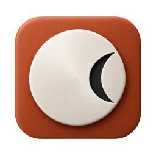
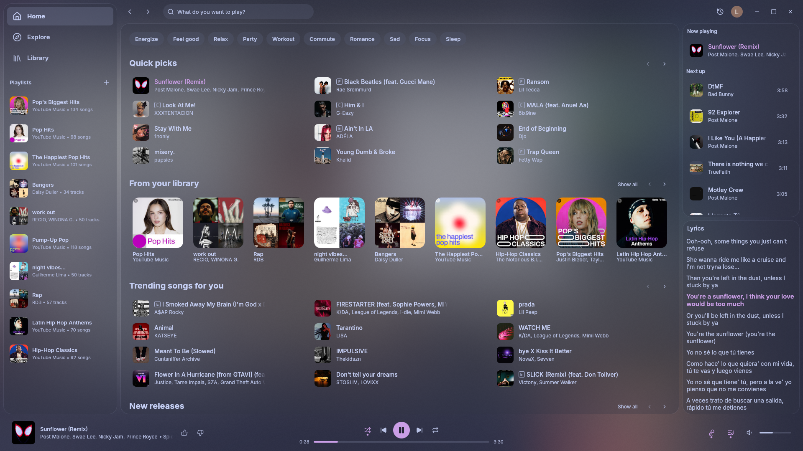

<p align="center">
  
</p>

# Moosik — a YouTube Music desktop client for serious listeners

**YouTube's music. A listener's app.**

Moosik is an open-source YouTube Music client with a native desktop interface, detailed listening stats, custom recaps, and a growing set of tools for people who care about their music library. Love YouTube Music's selection, but want a different UI? That's what we're building.

Our ambition is to make everyday listening feel better than Spotify: effortless queues, thoughtful library organization, and a listening history you can actually explore. This is an early project, and that ambition guides the roadmap.

**Built on [Refryt](https://github.com/gridoe/refryt), created by [gridoe](https://github.com/gridoe) and contributors.** Moosik is an independent fork; most of its playback engine and original desktop interface come from their work. The original history and GPL license are preserved.

[Get started](#get-started) · [Listening stats](docs/listening-stats.md) · [Roadmap](docs/ROADMAP.md) · [Contribute](CONTRIBUTING.md) · [Report a bug](https://github.com/AtotheY/moosik/issues/new?template=bug.yml)

> **Developer preview.** Moosik is running and being tested on Apple Silicon Macs. There are no published Moosik installers yet. Windows and Linux support is inherited from Refryt and needs validation with our changes. Start from source if you're comfortable with development builds.

## Built for the way you listen

### Your listening history, with the details left in

Explore listening time by **song, artist, album, and your own genre tags**. See repeat favorites, new discoveries, skips, completed listens, streaks, and when you listen most. Pick any date range and make your own recap instead of waiting for the end of the year.

Recording starts with playback in Moosik. It measures observed listening rather than counting paused or buffering time as music. Genres are manually assigned; unavailable metadata stays unknown. [See the definitions and limitations](docs/listening-stats.md).

### Your data, on your computer

The listening ledger lives locally in SQLite. Export song stats as CSV, the ledger as JSON, a database backup, or a recap as Markdown. Add personal star ratings and mood tags without publishing them to your YouTube profile.

These local stats are separate from YouTube's own account history. There is no cross-device history import or stats sync yet.

### A desktop music player that feels like one

Browse Home, albums, artists, search, and your library in a native Rust/egui interface. Use keyboard shortcuts, synced lyrics, the fullscreen player, and the queue. Hover a song for its **⋮** menu without shifting the row.

Refryt already provides the core listening experience, editable YouTube playlists, local-file playlists, themes, and desktop integrations. Moosik builds on that foundation with listener-focused stats and interface improvements.

### Make it feel like yours

Choose from the inherited theme collection, artwork-inspired headers, resizable sidebars, and transparency controls. Moosik adds ten Eclipse icon finishes, with Ceramic as the default; the live icon picker is implemented on macOS.

<details>
<summary>Preview the interface foundation inherited from Refryt</summary>

<p align="center">
  
</p>

This is an upstream Refryt screenshot, retained with credit. It shows the shared interface foundation, not Moosik's new listening-stats screens or a promised release build.

</details>

## Get started

**Current version: `0.1.14+ark.7` — source preview.**

| Platform | Moosik status |
| --- | --- |
| macOS, Apple Silicon | Locally built and tested; public installer and signing work are pending |
| Windows, x64 / ARM64 | Upstream build scripts exist; Moosik builds and hardware testing are pending |
| Linux | Upstream AppImage / Flatpak tooling exists; Moosik validation is pending |
| macOS, Intel | Not part of the current release workflow |
| iOS / Android | No Moosik app available |

### Build from source

Install Rust **1.90 or newer** and the platform dependencies in the [build guide](docs/BUILDING.md). The app uses `libmpv` for playback; `yt-dlp` supplies fallback resolution and other media features.

```sh
git clone https://github.com/AtotheY/moosik.git
cd moosik
cargo run --locked --release -p refryt --bin refryt
```

The internal crate and binary names are still `refryt`. Some bundle identifiers and storage paths also retain their original names to preserve existing installations. The `ark-*` scripts are maintainer-specific helpers, not a clean-install setup for other computers.

Follow [Moosik releases](https://github.com/AtotheY/moosik/releases) for future packages. Refryt's Homebrew, Scoop, AUR, and upstream releases install **Refryt**, not this fork. Automatic upstream binary updates are disabled in Moosik.

## What we're building next

- **Fluid drag and drop:** reorder the queue, drop songs into playlists, and insert tracks exactly where you want them.
- **Private music organization:** client-only playlists of streamed YouTube tracks, clearly separated from YouTube account playlists.
- **Deeper discovery in your own history:** richer comparisons, filters, and ways to revisit music you loved.
- **Install and go:** branded, verified desktop packages and a dependable update path.

These are planned improvements, not shipped features. [The roadmap](docs/ROADMAP.md) explains the current boundaries and what would make each step complete.

## Questions

### Is this a different YouTube Music UI or just the website in a window?

The main interface is native Rust/egui, inherited from Refryt. Moosik connects to YouTube Music for browsing and playback; it does not simply wrap the YouTube Music website. An embedded web view is used for Google sign-in.

### Is Moosik a Spotify alternative?

It is an alternative **desktop interface for YouTube Music**, aimed at listeners who like Spotify's desktop interactions and want deeper personal stats. It uses YouTube's service and catalog, not Spotify's. Spotify import and full Spotify-style drag and drop are not implemented yet.

### Will playlists appear on my YouTube account?

**YouTube playlist edits sync to YouTube.** Their visibility follows the playlist's YouTube settings; Moosik does not make them private automatically. Existing local playlists are for local audio files. Private client-only playlists of streamed YouTube songs are on the roadmap.

### Does it include my old YouTube Music listening history?

No. The detailed local ledger records playback observed in this Moosik installation. It does not backfill your Google account history or capture listening on another device. Your personal genre labels, ratings, and exports stay local unless you choose to share them.

### Do I need YouTube Music Premium?

Moosik follows Refryt's intended use with YouTube Premium or YouTube Music Premium. The inherited download feature checks for Premium. Moosik does not provide a subscription or grant rights to content; availability depends on YouTube and your account.

### How is my account stored?

On macOS, Moosik stores its reusable YouTube session in Keychain and verifies migration before removing the legacy session file. That protection is macOS-specific. Windows and Linux session storage has not received the equivalent Moosik migration. Google sign-in also uses the platform web view. Never share session files, cookies, or raw account diagnostics in an issue.

## Help shape Moosik

We're building this in the open for people who listen all day, collect albums, obsess over queues, and want more from their music history.

[Tell us where listening gets frustrating](https://github.com/AtotheY/moosik/issues/new?template=feature.yml), report a reproducible bug, or help test a platform. Design contributions should show the interaction in context and match the app's existing spacing, typography, and controls. See [CONTRIBUTING.md](CONTRIBUTING.md) before starting a larger change.

Star the repository if you want to find it again; use **Watch → Custom → Releases** for release notifications.

## Credits and license

**Refryt is the foundation of Moosik.** Thank you to [gridoe](https://github.com/gridoe), [Refryt's contributors](https://github.com/gridoe/refryt/graphs/contributors), and the projects below. This fork began at Refryt v0.1.14 ([`12e899c`](https://github.com/gridoe/refryt/commit/12e899c4b941728680c42ba1a3841d92769cd5f2)). Its playback, API integration, original layout, and much of the desktop functionality are their work.

Moosik's changes include a local listening ledger and recap interface, macOS session-storage hardening, Eclipse branding and icon choices, and song-row menu improvements. Moosik is maintained independently by [AtotheY](https://github.com/AtotheY). Please report fork-specific issues here rather than sending them upstream.

- **[Sonora](https://github.com/sonorahq/sonora)** and its
  [`ytmusic-rs`](https://github.com/sonorahq/ytmusic-rs): asking YouTube's `player` endpoint
  as the visionOS client, which hands back direct stream URLs, and retrying with the visitor
  id a refusal issues.
- **[yt-dlp](https://github.com/yt-dlp/yt-dlp)**: the fallback resolver, and the reference
  for how YouTube gates anonymous clients.
- **[youtui](https://github.com/nick42d/youtui)**: `ytmapi-rs` for the InnerTube API, and its
  maintained `rusty_ytdl` fork behind the optional native resolver.
- **[ytmdesktop](https://github.com/ytmdesktop/ytmdesktop)**: what happens when the queue
  runs out.
- **Spotify's desktop app**: the shortcuts, select-then-play clicks, and the shape of the
  album, playlist and artist pages.
- **[LRCLIB](https://lrclib.net)**: the synced lyrics.
- **Theme palettes**: [Catppuccin](https://github.com/catppuccin/palette),
  [Nord](https://www.nordtheme.com/docs/colors-and-palettes),
  [Gruvbox](https://github.com/morhetz/gruvbox),
  [Tokyo Night](https://github.com/folke/tokyonight.nvim),
  [Dracula](https://spec.draculatheme.com), [Rosé Pine](https://github.com/rose-pine/palette),
  [Everforest](https://github.com/sainnhe/everforest),
  [Solarized](https://ethanschoonover.com/solarized) and Spotify's own colours. Each file in
  `crates/refryt/themes` names its source.

Licensed under **[GPL-3.0-or-later](LICENSE)**, including this fork's changes. Existing copyright and license notices remain in place. When distributing binaries, provide the corresponding source and required notices under the GPL. Bundled dependencies retain their respective licenses.

Moosik is unofficial and is not affiliated with or endorsed by YouTube, Google, Spotify, or Refryt's maintainers. YouTube and YouTube Music are trademarks of Google LLC. It relies on undocumented YouTube interfaces that can change without notice; continued compatibility is not guaranteed. Use remains subject to the applicable service terms.
