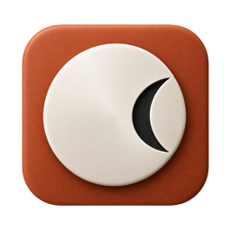
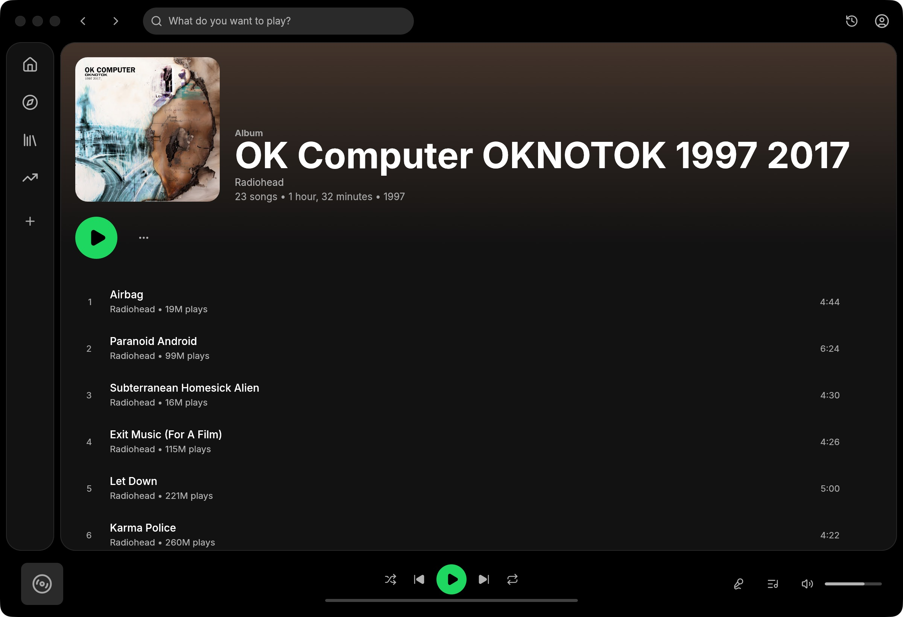
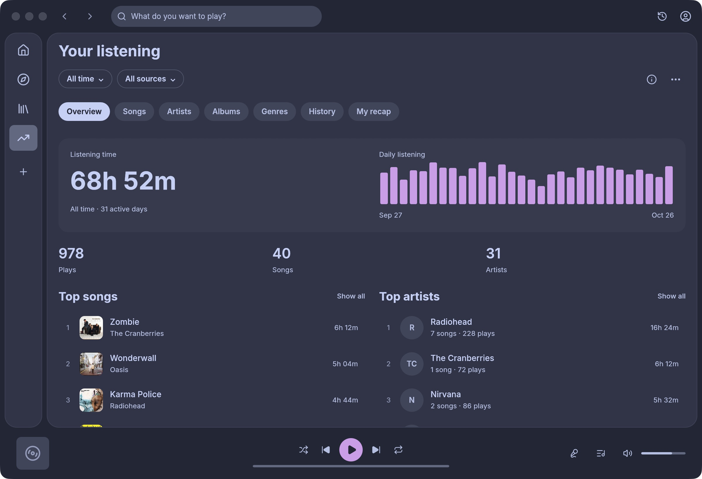
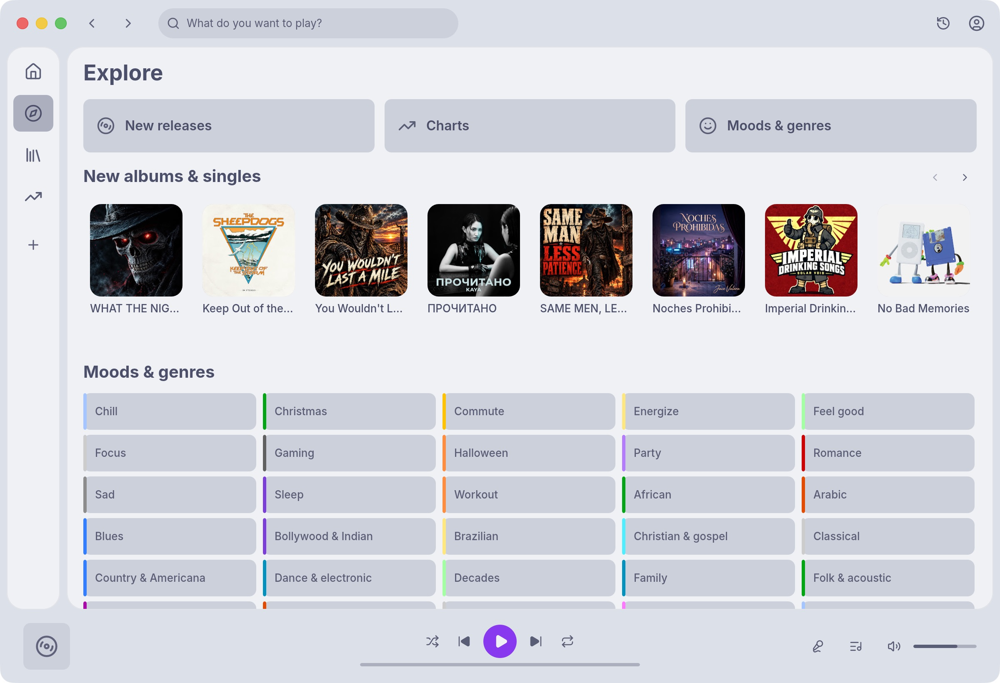
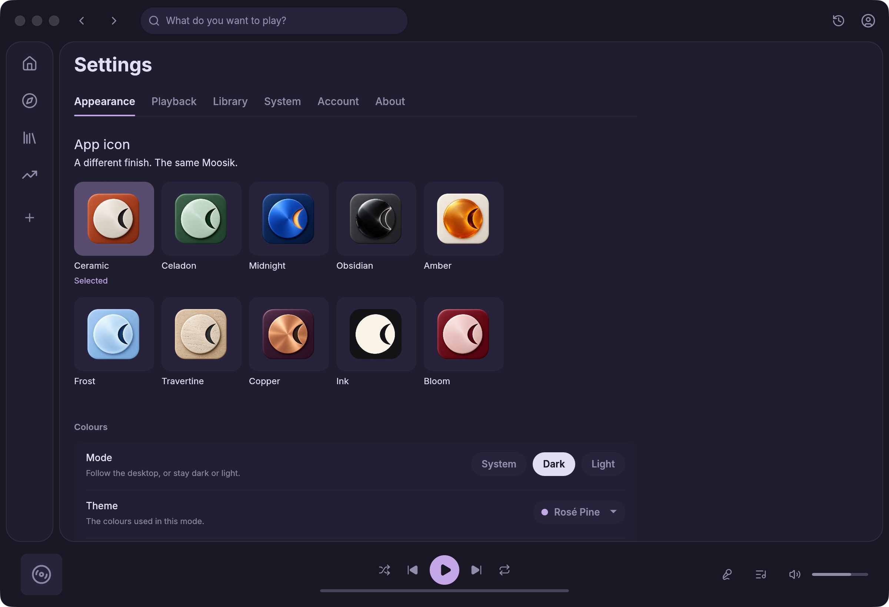

<p align="center">
  
</p>

# Moosik

A YouTube Music desktop player for macOS and Windows, with an editable queue and local listening stats.

[Download for Apple Silicon Mac](https://moosik.dev/?platform=mac#download) · [Windows x64 and all downloads](https://github.com/AtotheY/moosik/releases/latest)

Moosik is an independent fork of [Refryt](https://github.com/gridoe/refryt), by [gridoe](https://github.com/gridoe) and contributors. Its playback engine and original desktop interface come from their work.

[Install](#install) · [Listening stats](docs/listening-stats.md) · [Queue](docs/queue.md) · [Contribute](CONTRIBUTING.md) · [Report a bug](https://github.com/AtotheY/moosik/issues/new?template=bug.yml)

> Early release. Windows x64 is experimental; sign-in and playback still need testing on real hardware.

## Screenshots

macOS screenshots with signed-out browsing and synthetic listening stats. Click an image to open it at full size. [Screenshot details](assets/screenshots/moosik/README.md).

<table>
  <tr>
    <td width="50%"><a href="assets/screenshots/moosik/album-spotify.jpg"></a><br>Album · Spotify</td>
    <td width="50%"><a href="assets/screenshots/moosik/listening-catppuccin-frappe.jpg"></a><br>Listening stats · Catppuccin Frappé</td>
  </tr>
  <tr>
    <td width="50%"><a href="assets/screenshots/moosik/explore-catppuccin-latte.jpg"></a><br>Explore · Catppuccin Latte</td>
    <td width="50%"><a href="assets/screenshots/moosik/icons-rose-pine.jpg"></a><br>Appearance · Rosé Pine</td>
  </tr>
</table>

## Player

- Browse Home, Explore, albums, artists, search, and your YouTube Music library.
- Use keyboard shortcuts, synced lyrics, and the fullscreen player.
- Select and drag several songs in the [queue](docs/queue.md), remove upcoming tracks, and undo edits.
- Edit YouTube playlists or save songs and local files in private playlists on your computer. Save the current queue with **Queue → Save as private playlist**.
- Choose themes, resize sidebars, and adjust transparency. On macOS, pick from ten Eclipse app icons.
- [Share your listening activity on Discord](https://moosik.dev/guides/youtube-music-discord/).

## Listening history

Moosik records playback from this installation in a local SQLite database. Search past listens by title or artist, filter by date, and see listening time by song, artist, album, or your own genre tags. Stats include skips, completed listens, streaks, and listening patterns. Paused and buffering time are excluded.

Add personal ratings and mood tags, or make a recap for a date range. Export song stats as CSV, listening history as JSON, a database backup, or a recap as Markdown. These records, labels, and ratings stay on your computer unless you share them.

[Listening history guide](https://moosik.dev/guides/listening-history/) · [Stat definitions and limitations](docs/listening-stats.md)

## Install

Download a package from the [latest release](https://github.com/AtotheY/moosik/releases/latest) or [moosik.dev](https://moosik.dev/#download).

| Platform | Package and status |
| --- | --- |
| macOS, Apple Silicon | DMG installer and signed in-app updates. See the release for macOS requirements. |
| Windows, x64 | Experimental setup EXE and portable ZIP. |

On macOS, open the DMG and drag Moosik to Applications. First launch may require approval in **System Settings → Privacy & Security**. See [in-app updates](docs/client-updates.md) for signing and update details.

Use Moosik with a YouTube Premium or YouTube Music Premium account. The download feature checks for Premium; content availability depends on YouTube and your account.

### Build from source

Install Rust 1.90 or newer and the platform dependencies in the [build guide](docs/BUILDING.md). Playback uses `libmpv`; `yt-dlp` provides fallback resolution and other media features.

```sh
git clone https://github.com/AtotheY/moosik.git
cd moosik
cargo run --locked --release -p refryt --bin refryt
```

The crate and binary are named `refryt`. Some bundle identifiers and storage paths also use that name.

## Account and playlists

Google sign-in opens an embedded web view. On macOS, Moosik stores the saved YouTube session in Keychain. Windows and Linux use session files.

YouTube playlist edits sync to your account and follow each playlist's visibility settings. Choose **Save privately** to keep a playlist on this computer.

Keep session files, cookies, and raw account diagnostics private. Review logs and exports before sharing them in an issue.

## Contribute

[Report a bug](https://github.com/AtotheY/moosik/issues/new?template=bug.yml), [suggest a feature](https://github.com/AtotheY/moosik/issues/new?template=feature.yml), or help test a platform. Read [CONTRIBUTING.md](CONTRIBUTING.md) before starting a larger change. Planned work is in the [roadmap](docs/ROADMAP.md).

## Credits and license

- [Refryt contributors](https://github.com/gridoe/refryt/graphs/contributors): playback, API integration, and the original desktop interface.
- [Sonora](https://github.com/sonorahq/sonora) and [`ytmusic-rs`](https://github.com/sonorahq/ytmusic-rs): direct stream URL resolution.
- [yt-dlp](https://github.com/yt-dlp/yt-dlp): fallback resolution.
- [youtui](https://github.com/nick42d/youtui): `ytmapi-rs` and the `rusty_ytdl` fork used by the optional native resolver.
- [ytmdesktop](https://github.com/ytmdesktop/ytmdesktop): queue continuation.
- Spotify's desktop app: shortcuts, selection behavior, and album, playlist, and artist page layouts.
- [LRCLIB](https://lrclib.net): synced lyrics.
- Theme palettes: [Catppuccin](https://github.com/catppuccin/palette),
  [Nord](https://www.nordtheme.com/docs/colors-and-palettes),
  [Gruvbox](https://github.com/morhetz/gruvbox),
  [Tokyo Night](https://github.com/folke/tokyonight.nvim),
  [Dracula](https://spec.draculatheme.com), [Rosé Pine](https://github.com/rose-pine/palette),
  [Everforest](https://github.com/sainnhe/everforest),
  [Solarized](https://ethanschoonover.com/solarized) and Spotify's own colours. Each file in
  `crates/refryt/themes` names its source.

Maintained by [AtotheY](https://github.com/AtotheY). Licensed under [GPL-3.0-or-later](LICENSE), including this fork's changes. Existing copyright notices and dependency licenses apply.

Moosik is an unofficial client. YouTube and YouTube Music are trademarks of Google LLC. It uses undocumented YouTube interfaces, so service changes can affect browsing and playback. Use is subject to the applicable service terms.
